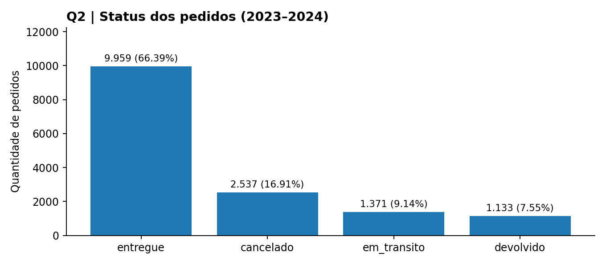
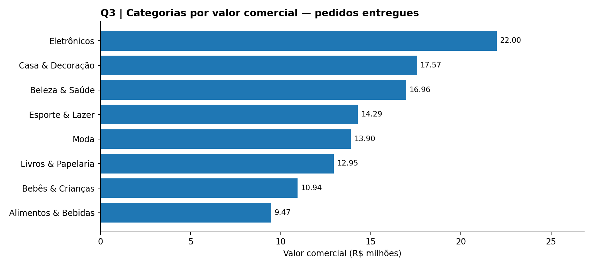
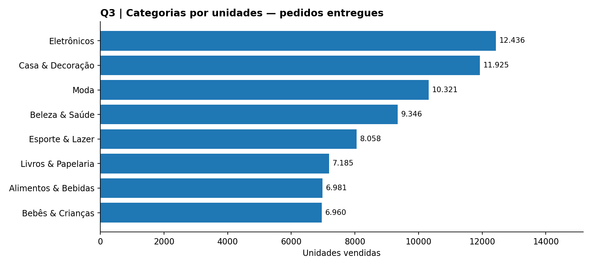
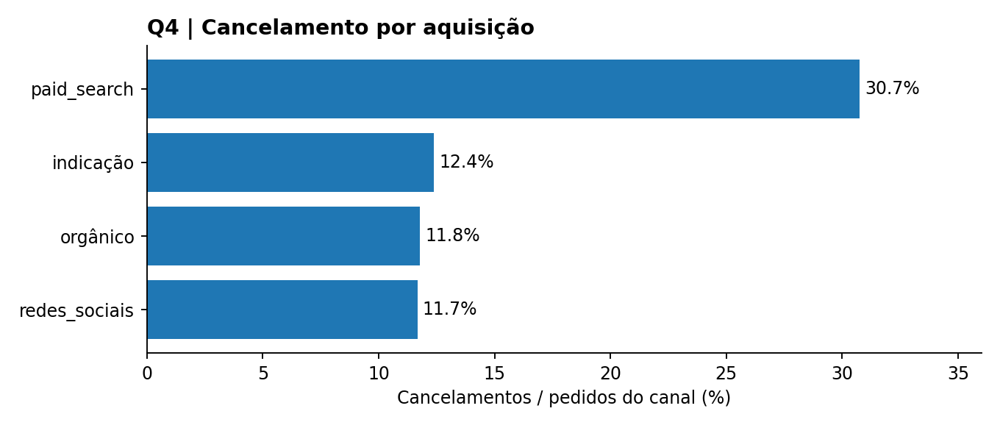
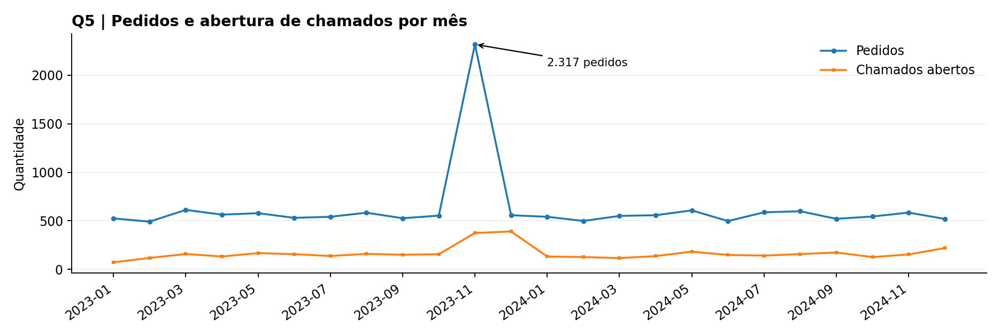
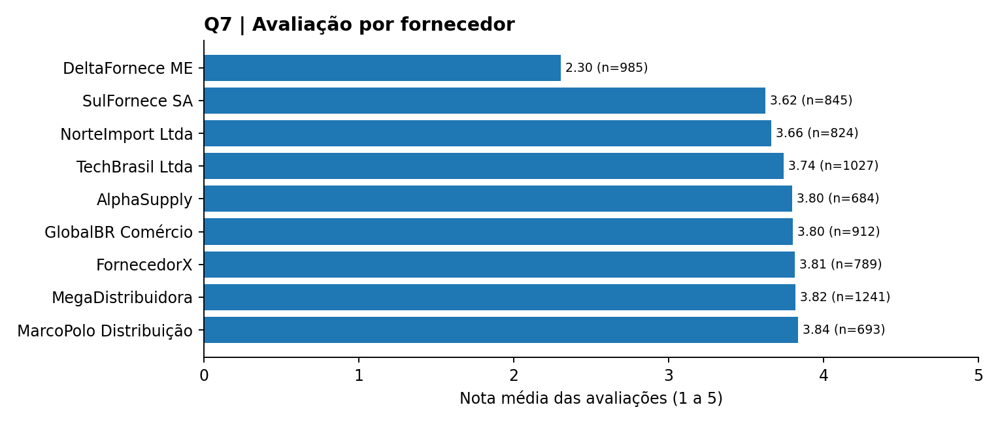

# OrbitShop — Análise de Dados

Projeto de análise de dados desenvolvido para o **case individual de Digital Consulting da Peers Consulting**, com base na operação fictícia de e-commerce **OrbitShop**.

A solução responde às questões **Q1–Q9**, investiga divergências entre indicadores executivos, reconcilia dados comerciais, analisa cancelamentos e chamados de suporte e apresenta **uma recomendação priorizada ao conselho**. Toda conclusão é acompanhada de código reproduzível, testes, gráficos e ressalvas metodológicas.

> Este repositório é um projeto de **análise de dados**, não uma API ou aplicação web. Os valores financeiros reconstruídos são indicadores comerciais e **não representam receita contábil auditada**.

## Funcionalidades

- Leitura das seis tabelas originais do Excel sem alterar os arquivos de entrada.
- Auditoria de qualidade: chaves, duplicações, integridade referencial, datas e valores ausentes.
- Distribuição de pedidos por status e comparação das taxas de cancelamento entre 2023 e 2024.
- Ranking de categorias por **valor dos itens** e **unidades vendidas**.
- Análise de cancelamentos e ticket médio por **canal de aquisição**, ano e segmento B2B/B2C.
- Série mensal de pedidos e chamados de suporte, com análise de coortes.
- Reconciliação entre o total informado do pedido e a soma de seus itens.
- Comparação de fornecedores por avaliações e incidência de chamados, sem atribuição indevida de tickets multifornecedor.
- Recomendação executiva única, com trade-off e identificação dos dados faltantes.
- Exportação de CSVs, gráficos PNG, métricas JSON, relatório técnico e memo executivo PDF.
- Testes automatizados, auditoria via SQLite e reprodução determinística de resultados.
- Empacotamento em ZIP com manifesto de integridade SHA-256.

## Tecnologias

| Tecnologia | Versão/requisito | Uso |
|---|---|---|
| Python | 3.11+ | Linguagem principal |
| Biblioteca padrão (zipfile e XML) | Incluída no Python | Leitura do XLSX original |
| SQLite (sqlite3) | Incluído no Python | Conferência independente das métricas |
| Matplotlib | 3.7+ e inferior a 4.0 | Gráficos |
| ReportLab | 4.x | Geração do PDF |
| pypdf | 5.x ou 6.x | Verificação do PDF |
| pytest | 8.x ou 9.x | Testes automatizados |
| GitHub Actions | Workflow do repositório | Integração contínua |

O leitor Excel é específico para o esquema OOXML utilizado neste case. **Não são necessários banco de dados externo, credenciais ou serviços de nuvem.**

## Demonstração

### Status dos pedidos — Q2

Distribuição dos pedidos entre entregues, cancelados, em trânsito e devolvidos, com comparação das taxas por ano da compra.

### Categorias mais vendidas — Q3

Comparação dos rankings por valor comercial dos itens e quantidade de unidades vendidas.

### Aquisição e cancelamentos — Q4

A análise distingue o canal de **aquisição do cliente** do canal de **venda do pedido**.

### Evolução mensal — Q5

Série de 2023–2024: picos de pedidos e comparação com chamados, sem presumir causalidade.

### Fornecedores e suporte — Q7

Comparação de avaliações e chamados em pedidos de fornecedor único, evitando atribuições indevidas.

## Principais resultados

| Indicador | Resultado |
|---|---:|
| Pedidos analisados | 15.000 |
| Clientes cadastrados | 3.000 |
| Produtos no catálogo | 200 |
| Itens de pedido | 36.740 |
| Chamados de suporte | 4.000 |
| Avaliações | 8.000 |
| Pedidos cancelados | 2.537 (16,91%) |
| Cancelamentos de clientes adquiridos via paid_search | 1.219 em 3.965 pedidos (30,74%) |
| Pico mensal de pedidos | Novembro/2023: 2.317 |
| Pedidos com valor total informado | 14.921 |
| Pedidos conciliados à soma dos itens (±R$ 0,01) | 0 |

A taxa de cancelamento foi **16,78% em 2023** e **17,09% em 2024** (por ano de criação do pedido), apesar de a quantidade absoluta de cancelamentos ter diminuído. **DeltaFornece ME** teve as piores avaliações, mas os dados não demonstram que explique sozinho o aumento de suporte.

**Recomendação:** congelar **a expansão**, e não necessariamente as operações atuais, do investimento em mídia paga (paid_search) até esclarecer os motivos dos cancelamentos. A decisão tem custo de oportunidade e não permite estimar recuperação de margem em reais.

Consulte o [relatório técnico completo](docs/RELATORIO_TECNICO.md) para as fórmulas, tabelas e ressalvas.

## Organização do código

~~~text
PROJETO_PEERS/
├── input/                   Base Excel e enunciado PowerPoint originais
├── src/
│   ├── workbook.py          Leitura do XLSX
│   ├── data_quality.py      Auditoria da base
│   ├── validation.py        Validação dos dados
│   ├── analysis.py          Métricas compartilhadas
│   ├── q2.py ... q7.py      Análises por questão
│   ├── q8_q9.py             Recomendação e lacunas
│   ├── audit_review.py      Auditoria independente
│   └── run.py               Execução principal
├── scripts/
│   ├── build_deliverables.py       Memo PDF e relatório
│   ├── run_data_audit.py           Auditoria exploratória
│   ├── verify_reproducibility.py   Reprodução independente
│   └── package_release.py         ZIP com manifesto SHA-256
├── tests/                   Testes de regressão e integração
├── outputs/                 Gráficos, tabelas e indicadores
├── docs/                    Documentação metodológica e auditorias
├── MEMO_FINAL.md            Texto editável do memo
├── MEMO_ORBITSHOP.pdf       Memo executivo de uma página
├── Q1_CONGELADA_PRE_ANALISE.md
└── requirements.txt
~~~

## Como executar

### Pré-requisitos

- Python 3.11 ou superior.
- Git para clonar o repositório.
- Terminal (PowerShell, bash ou equivalente).

### 1. Clonar o projeto

~~~bash
git clone https://github.com/RicardoSenna4/PROJETO_PEERS.git
cd PROJETO_PEERS
~~~

### 2. Criar e ativar o ambiente virtual

**Windows (PowerShell):**

~~~powershell
python -m venv .venv
.\.venv\Scripts\Activate.ps1
~~~

**Linux/macOS:**

~~~bash
python3 -m venv .venv
source .venv/bin/activate
~~~

### 3. Instalar as dependências

~~~bash
python -m pip install -r requirements.txt
~~~

### 4. Executar a análise

~~~bash
python -m src.run --input input/Base_Dados_OrbitShop_v3.xlsx --output outputs
~~~

O comando lê a base, valida os registros e regenera métricas, CSVs, gráficos e relatórios.

### 5. Gerar o memo executivo

~~~bash
python scripts/build_deliverables.py
~~~

O gerador utiliza os resultados de **outputs/metricas.json** e deve ser executado após a análise. Produz **MEMO_FINAL.md** e **MEMO_ORBITSHOP.pdf**.

### 6. Executar testes e validar reprodução

~~~bash
python -m pytest -q
python -m scripts.verify_reproducibility
~~~

Para rodar somente a auditoria da base:

~~~bash
python -m scripts.run_data_audit
~~~

## Arquivos gerados

| Arquivo | Conteúdo |
|---|---|
| [outputs/q2_status.csv](outputs/q2_status.csv) | Distribuição por status |
| [outputs/q3_comparacao_entregues.csv](outputs/q3_comparacao_entregues.csv) | Ranking de categorias por valor e unidades |
| [outputs/q4_canais.csv](outputs/q4_canais.csv) | Aquisição, cancelamentos e ticket médio |
| [outputs/q5_mensal.csv](outputs/q5_mensal.csv) | Pedidos e suporte em 24 meses |
| [outputs/q6_reconciliacao_pedido.csv](outputs/q6_reconciliacao_pedido.csv) | Reconciliação dos 15.000 pedidos |
| [outputs/q7_fornecedores.csv](outputs/q7_fornecedores.csv) | Avaliações e chamados por fornecedor |
| [outputs/q8_q9_decisao.json](outputs/q8_q9_decisao.json) | Recomendação e lacunas de dados |
| [outputs/q12_auditoria.json](outputs/q12_auditoria.json) | Auditoria independente de métricas |
| [MEMO_ORBITSHOP.pdf](MEMO_ORBITSHOP.pdf) | Memo executivo final |

## Metodologia

- **Q1:** as perguntas foram registradas antes da leitura da base, conforme [documento congelado](Q1_CONGELADA_PRE_ANALISE.md).
- **Q2:** cancelamento = pedidos distintos com status cancelado / total de pedidos; anos por data de compra, não de cancelamento.
- **Q3:** valor comercial = quantidade × preço praticado em pedidos entregues. O preço já incorpora o desconto informado; não descontar duas vezes.
- **Q4:** agrupamento por canal de aquisição do cliente. O ticket registrado não corresponde necessariamente à receita reconhecida.
- **Q5:** série mensal contínua; a incidência de suporte por coorte conta pedidos distintos com chamado, não o número bruto de tickets dividido por pedidos.
- **Q6:** os 79 valores totais ausentes são preservados. Nenhum dos 14.921 totais preenchidos conciliou com os itens a ±R$ 0,01.
- **Q7:** chamados de pedidos com vários fornecedores não são atribuídos individualmente a um deles.
- **Q8/Q9:** recomendação preventiva única, com custo de oportunidade e dados necessários para investigar causalidade.

A metodologia completa consta em [Contrato de métricas](docs/03_METRICAS_E_ASSUNCOES.md), [Auditoria de dados](docs/02_AUDITORIA_DADOS.md) e [Auditoria adversarial](docs/12_AUDITORIA_ADVERSARIAL.md).

## Testes

~~~bash
python -m pytest -q
~~~

A validação final documentada registrou **83 testes aprovados**, além de **15 verificações independentes em SQLite**. O verificador de reprodução confirmou **29 artefatos textuais idênticos** em duas execuções. O [GitHub Actions](.github/workflows/ci.yml) executa a suíte, reproduz as métricas e confere a integridade das fontes.

## Entrega

O [memo executivo em PDF](MEMO_ORBITSHOP.pdf) tem **uma página A4 e 356 palavras**. Ele inclui a Q1 no topo, conclusões das questões Q2–Q9, uma ação recomendada com trade-off e declaração do uso de IA.

Para criar um ZIP completo, incluindo os arquivos originais, os scripts, os testes e as saídas:

~~~bash
python -m scripts.package_release --output ../OrbitShop_Case_Peers_Entrega_Final.zip
~~~

O pacote inclui um manifesto SHA-256. Consulte o [Checklist de entrega](docs/15_CHECKLIST_ENTREGA.md).

> **Limitações:** não há trilha detalhada de cancelamentos, dados para conciliação contábil ou identificação do fornecedor responsável por chamados de pedidos multifornecedor. Correlações não são prova de causalidade, e a soma dos itens não deve ser apresentada como faturamento auditado.

## Autor

**Ricardo Sena**

[GitHub](https://github.com/RicardoSenna4) · [Repositório](https://github.com/RicardoSenna4/PROJETO_PEERS)
