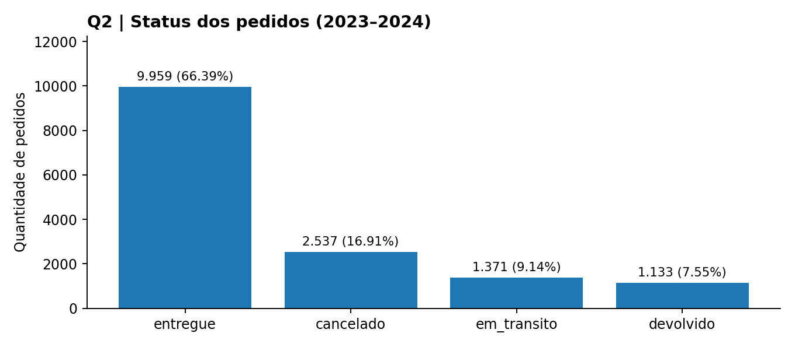
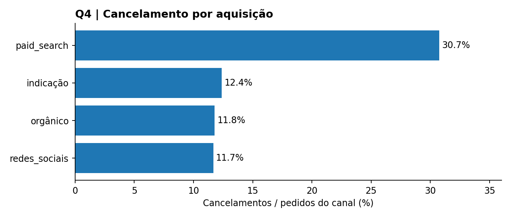
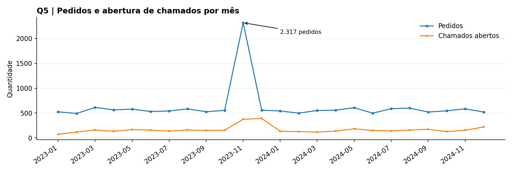
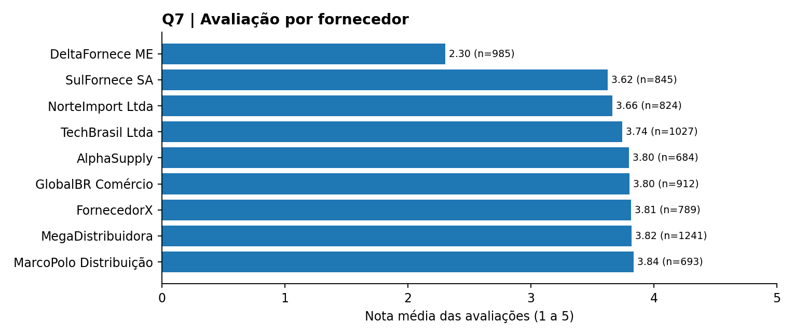

# Relatório técnico — OrbitShop (Q1–Q9)

**Fonte da verdade:** `input/Base_Dados_OrbitShop_v3.xlsx` e `input/Case_OrbitShop_Individual_v2.pptx`. Indicadores gerados por `python -m src.run`. Gráficos e CSVs em `outputs/`. Documento técnico auxiliar: o memo é a entrega executiva de uma página.

## Q1 — Perguntas preservadas antes da análise

**Q1 — Três perguntas (congeladas antes da leitura da base)**

1. **Camila:** os 40% representam aumento no número absoluto de cancelamentos ou na taxa de cancelamento, e qual denominador foi usado?
2. **Rogério:** qual evento faz um pedido contar como cancelado no seu relatório e em que momento ele é reconhecido?
3. **Ambos:** vocês usam os mesmos períodos de referência, filtros de clientes e canais e critérios de inclusão de pedidos?

## Auditoria de dados

| Tabela | Registros | Campos ausentes |
| --- | --- | --- |
| Clientes | 3.000 | nenhum |
| Produtos | 200 | nenhum |
| Pedidos | 15.000 | valor_total: 79 |
| Itens_Pedido | 36.740 | desconto_aplicado: 301 |
| Tickets_Suporte | 4.000 | data_resolucao: 1653 |
| Avaliacoes | 8.000 | comentario: 1679 |

As chaves estrangeiras declaradas retornaram **zero órfãos**; `Tickets_Suporte` e `Avaliacoes` respeitam cliente do pedido, datas posteriores à compra e avaliação de produto realmente comprado. O grão das tabelas foi preservado (não somar `Pedidos.valor_total` após join com múltiplos itens).

## Q2 — Status e contradição dos executivos

| Status | Pedidos | % do total |
| --- | --- | --- |
| entregue | 9.959 | 66,39% |
| cancelado | 2.537 | 16,91% |
| em_transito | 1.371 | 9,14% |
| devolvido | 1.133 | 7,55% |

2023: **1.407 cancelados / 8.386 pedidos = 16,78%**. 2024: **1.130 / 6.614 = 17,09%**.

Portanto, a quantidade caiu **19,69%** e a taxa subiu **0.307 p.p.** (1,83% de crescimento relativo da taxa). Os 40% alegados e os 18%→16% alegados não se reproduzem na base sob a mesma coorte (ano de `data_pedido`). Não há histórico de data de cancelamento para comparar períodos por evento de cancelamento.

## Q3 — Categorias (pedidos entregues, valores brutos de itens)

| Categoria | Valor bruto de itens | Unidades | Preço médio ponderado |
| --- | --- | --- | --- |
| Eletrônicos | R$ 21.999.024,44 | 12.436 | R$ 1.768,98 |
| Casa & Decoração | R$ 17.568.904,23 | 11.925 | R$ 1.473,28 |
| Beleza & Saúde | R$ 16.962.519,83 | 9.346 | R$ 1.814,95 |
| Esporte & Lazer | R$ 14.293.636,88 | 8.058 | R$ 1.773,84 |
| Moda | R$ 13.902.592,20 | 10.321 | R$ 1.347,02 |
| Livros & Papelaria | R$ 12.951.931,61 | 7.185 | R$ 1.802,63 |
| Bebês & Crianças | R$ 10.935.414,92 | 6.960 | R$ 1.571,18 |
| Alimentos & Bebidas | R$ 9.470.586,39 | 6.981 | R$ 1.356,62 |

**Ranking de valor:** Eletrônicos > Casa & Decoração > Beleza & Saúde > Esporte & Lazer > Moda > Livros & Papelaria > Bebês & Crianças > Alimentos & Bebidas.

**Ranking de volume:** Eletrônicos > Casa & Decoração > Moda > Beleza & Saúde > Esporte & Lazer > Livros & Papelaria > Alimentos & Bebidas > Bebês & Crianças.

As listas não coincidem integralmente: Moda passa de terceira em quantidade para quinta em valor. A diferença é compatível com a variação de preço médio ponderado. Esses valores são **valor bruto comercial potencial dos itens de pedidos com status `entregue`**, não receitas contábeis; os cenários `Q3_nao_cancelados` e `Q3_todos` estão em `outputs/` para sensibilidade.

## Q4 — Aquisição de clientes e cancelamentos

| Canal de aquisição | Pedidos | Cancelados | Taxa | Ticket médio* | Nulos* |
| --- | --- | --- | --- | --- | --- |
| paid_search | 3.965 | 1.219 | 30,74% | R$ 2.576,54 | 16 |
| indicação | 3.658 | 453 | 12,38% | R$ 2.531,85 | 11 |
| orgânico | 3.616 | 426 | 11,78% | R$ 2.515,08 | 16 |
| redes_sociais | 3.761 | 439 | 11,67% | R$ 2.651,49 | 15 |

*Ticket médio calculado exclusivamente nos pedidos entregues com `Pedidos.valor_total` informado; **não representa receita comprovada**, devido à Q6. A amostra total de pedidos entregues é 9.959; com valor válido, 9.901. O canal `paid_search` reúne **48,05%** dos cancelamentos embora represente **26,43%** dos pedidos. O padrão persiste em estratos B2B e B2C e nos dois anos (arquivo `outputs/q4_estratos.csv`). Associação não demonstra causalidade, e variações de ticket registrado devem ser interpretadas com cautela.

## Q5 — Série mensal e hipóteses

| Mês | Pedidos criados | Chamados abertos |
| --- | --- | --- |
| 2023-01 | 525 | 73 |
| 2023-02 | 492 | 118 |
| 2023-03 | 613 | 159 |
| 2023-04 | 564 | 133 |
| 2023-05 | 579 | 168 |
| 2023-06 | 531 | 157 |
| 2023-07 | 542 | 138 |
| 2023-08 | 584 | 160 |
| 2023-09 | 527 | 151 |
| 2023-10 | 554 | 156 |
| 2023-11 | 2.317 | 375 |
| 2023-12 | 558 | 391 |
| 2024-01 | 542 | 133 |
| 2024-02 | 499 | 127 |
| 2024-03 | 551 | 117 |
| 2024-04 | 558 | 137 |
| 2024-05 | 608 | 183 |
| 2024-06 | 498 | 149 |
| 2024-07 | 588 | 142 |
| 2024-08 | 599 | 158 |
| 2024-09 | 521 | 174 |
| 2024-10 | 545 | 127 |
| 2024-11 | 585 | 154 |
| 2024-12 | 520 | 220 |

- **Novembro/2023** teve 2.317 pedidos vs 500–600 na maioria dos meses: hipótese não comprovada de campanha/promoção; solicitar calendário de campanhas.
- **Maio/2024**, com 608 pedidos, foi o maior mês de 2024, mas a amplitude anual é modesta; hipótese: variação sazonal/comercial normal, sem comprovação.
- O pico de chamados foi em **novembro (375) e dezembro/2023 (391)**. Dos 766 chamados abertos nos dois meses, 603 (78,72%) se referem a pedidos feitos em novembro. O volume extra de pedidos contribui para o pico; o dataset não estabelece que a operação piorou.
- Na coorte de novembro/2023, 603 de 2.317 pedidos abriram ao menos um chamado (26,02%), similar aos meses vizinhos. Taxas por coorte em `outputs/q5_coortes_suporte.csv`.

## Q6 — Reconciliação financeira crítica

- 15.000 pedidos; **79 com `valor_total` ausente**; 301 pedidos contendo desconto sem informação em pelo menos um item.
- Dos 14.921 valores disponíveis, **0 conciliam** à soma de `quantidade × preco_praticado` por pedido, com tolerância de R$ 0,01. O cenário de reaplicar o desconto foi descartado por **dupla dedução** do preço praticado.
- **Soma de `Pedidos.valor_total` não nulos**: R$ 38.418.252,65. **Soma bruta dos itens nos mesmos pedidos**: R$ 175.861.677,47. **Diferença assinada (reportado − bruto)**: R$ -137.443.424,82. A soma de diferenças absolutas é R$ 150.370.865,92; 13.079 totais menores e 1.842 maiores.
- **Todos os itens, inclusive pedidos sem total reportado**: R$ 176.730.490,88; apenas status `entregue`: R$ 118.084.610,50. **Não reaplicar desconto** ao preço praticado já líquido de descontos conhecidos. Para valores ausentes, preservar a ausência e solicitar a regra financeira à empresa.
- **Escolha para conselho:** não apresentar o valor registrado como receita auditada, nem a soma bruta como receita reconhecida. Para evidenciar escala comercial, reportar volume de pedidos, quantidade de itens e **valor bruto de itens em pedidos entregues** com rótulo de *proxy não contábil*, condicionando qualquer afirmação de receita/margem à conciliação com transações financeiras, reembolsos, frete, impostos e descontos efetivos. O arquivo `outputs/q6_reconciliacao_pedido.csv` contém todos os 15.000 confrontos.

## Q7 — Avaliações de fornecedores e chamados de suporte

| Fornecedor | Avaliações | Nota média | % nota ≤ 2 | Pedidos mono | Ticket/mono |
| --- | --- | --- | --- | --- | --- |
| DeltaFornece ME | 985 | 2.30 | 59,90% | 596 | 24,66% |
| SulFornece SA | 845 | 3.62 | 22,37% | 558 | 26,52% |
| NorteImport Ltda | 824 | 3.66 | 22,09% | 517 | 27,08% |
| TechBrasil Ltda | 1.027 | 3.74 | 20,25% | 660 | 27,58% |
| AlphaSupply | 684 | 3.80 | 18,13% | 380 | 27,89% |
| GlobalBR Comércio | 912 | 3.80 | 17,43% | 561 | 27,27% |
| FornecedorX | 789 | 3.81 | 18,76% | 494 | 28,74% |
| MegaDistribuidora | 1.241 | 3.82 | 17,73% | 755 | 24,64% |
| MarcoPolo Distribuição | 693 | 3.84 | 17,75% | 439 | 27,33% |

O fornecedor **DeltaFornece ME** é um outlier negativo de avaliações: 59,90% das 985 avaliações têm nota ≤2, ante taxas significativamente inferiores nos outros fornecedores. Contudo, os 147 chamados nos 596 pedidos exclusivamente de seus produtos representam 24,66%, sem taxa anormalmente alta comparada aos pares.

**Cautela de granularidade:** 10.040 pedidos contêm mais de um fornecedor e **2.676 chamados** referem-se a esses pedidos; o fornecedor responsável pelo ticket não é identificado. As colunas "fornecedor presente no pedido" são associações, não atribuição de culpa. As categorias dos chamados no último trimestre de 2023 são múltiplas: troca 173, defeito 149, cobrança 152, dúvida 228, atraso 220. O pico está temporalmente ligado ao volume excepcional de compras em novembro, portanto o problema da Delta é apenas parte da história.

## Q8 — Uma ação e seu custo de oportunidade

**Ação imediata recomendada:** congelar **a expansão de investimento em `paid_search`** até esclarecer os motivos dos cancelamentos desse canal, sem assumir que toda campanha atual deve ser desligada. O canal concentra **1.219 cancelamentos (48,05% do total)**, taxa **30,74%** contra 11,67%–12,38% nos outros canais; a diferença se mantém por ano e segmento. **Indicador de sucesso:** queda sustentada da taxa de cancelamento do canal usando a mesma definição e coortes comparáveis, monitorando também pedidos e conversão. **Trade-off explícito:** adiar intervenção imediata na qualidade do fornecedor Delta; o risco é perder crescimento de vendas provenientes de mídia paga. *Sem reconciliação financeira não é possível prometer recuperação de margem em reais.*

## Q9 — Pergunta sem resposta e dados faltantes

**Por que os pedidos originados de `paid_search` cancelam mais: problema de pagamento, fraude, expectativa comercial, estoque ou logística?** Exigir motivo de cancelamento por pedido, data/hora de mudanças de status, tentativas/autorização/estorno de pagamento, campanha/anúncio e custo de aquisição, registros de estoque/prazo e eventos do funil. Também requisitar componentes financeiros necessários para reconciliar `valor_total` com itens. Sem isso, a ação é preventiva e sujeita a revisão, não uma conclusão causal.

## Uso de IA e verificação

IA foi utilizada para prototipar o leitor XLSX, cálculos, visualização e redação. **Erro de simplificação identificado:** aplicar `desconto_aplicado` novamente ao `preco_praticado`, que já embute o desconto. Correção: somente `quantidade × preco_praticado` como proxy e 79 `valor_total` nulos mantidos. Há 301 pedidos com informação de desconto ausente. Houve ainda correção de uma dependência indevida do canal `paid_search` em teste sintético, e otimização de teste que reconstruía o índice de pedidos repetidamente. Foram executados **74 testes** com pytest, além de cruzamentos independentes com SQLite para status e aquisição. O relatório não atribui à IA verificação humana externa que não ocorreu.

## Limites

Os status são fotografias atuais sem histórico de eventos. Não há comprovantes de pagamento, histórico de cancelamento, origem por produto dos tickets em pedidos multifornnecedor, cronograma de campanhas ou despesas de aquisição. Valores brutos não equivalem a faturamento e variações associativas não demonstram causalidade.
